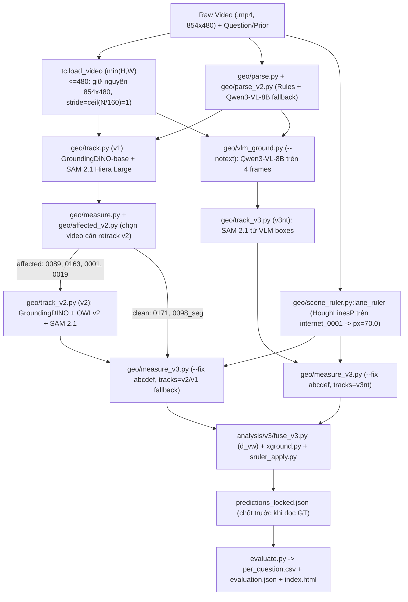

# IIIXR trên Kaggle GPU T4 x2

[Validation 3D gồm 90 câu trên 12 video](kaggle/three_d/README.md)

## Nhánh đo chuyển động 2D `g_box`

Thư mục này chứa mã nguồn upstream đã pin và gói thực thi/instrumentation trên Kaggle `GPU T4 ×2` cho nhánh đo chuyển động 2D (`g_box`, `mode_box="2d_ratio"`) của đội **IIIXR** (CVPR/NeurIPS QuantiPhy Challenge).

---

## 1. Nguồn chuẩn, Commit Pin & Lưu ý Giấy phép

- **Upstream repository:** `https://github.com/seoneun/NeurIPS-2026-QuantiPhy-Challenge-IIIXR.git`
- **Pinned commit SHA:** `ec4bfc15e9d5d1372bea0ecafdadf54c6e38b378`
- **Đường dẫn subtree trong repo tổng:** `solutions/iiixr/upstream/` (được nhập nguyên bản bằng `git subtree add --prefix=solutions/iiixr/upstream iiixr-source ec4bfc15e9d5d1372bea0ecafdadf54c6e38b378 --squash`, tách biệt hoàn toàn với commit viết gói `solutions/iiixr/kaggle/`).
- **Fork cá nhân:** Chưa tạo fork riêng (đang nhập trực tiếp từ repo gốc; khi tạo fork có thể đổi URL của remote `iiixr-source`).
- **Tình trạng giấy phép (License Audit):**
  - Repo upstream `seoneun/NeurIPS-2026-QuantiPhy-Challenge-IIIXR` tại commit `ec4bfc15e9d5...` **không có file `LICENSE` riêng** ở thư mục gốc. Mọi quyền tác giả đối với các file bên trong `solutions/iiixr/upstream/` thuộc về nhóm tác giả IIIXR.
  - Bốn model HuggingFace thực sự tham gia nhánh `g_box` (`IDEA-Research/grounding-dino-base`, `google/owlv2-base-patch16-ensemble`, `facebook/sam2.1-hiera-large`, `Qwen/Qwen3-VL-8B-Instruct`) đều mang giấy phép **Apache-2.0** (ghi trong `upstream/MODELS.md`). Các model khác trong `MODELS.md` (như `VGGT-1B` CC-BY-NC-4.0, `Sa2VA-Qwen3-VL-4B-SAM3`, `MoGe-2`, `Molmo2-8B`, `CoTracker3`, `Code-as-World-VL-9B`, `Kimi-K2.5`) **không tham gia nhánh `g_box` 2D** và được loại khỏi luồng tải/chạy.
- **Thay đổi đối với `solutions/iiixr/upstream/`:** `0` dòng sửa đổi (`git diff` trên `solutions/iiixr/upstream/` hoàn toàn rỗng). Toàn bộ launcher, instrumentation, bộ cô lập nhãn, verifier và viewer đặt tách biệt tại `solutions/iiixr/kaggle/`.

### Đồng bộ lại subtree khi cần cập nhật upstream

```bash
git remote add iiixr-source https://github.com/seoneun/NeurIPS-2026-QuantiPhy-Challenge-IIIXR.git  # nếu clone mới chưa có remote
git fetch iiixr-source main
git subtree pull --prefix=solutions/iiixr/upstream iiixr-source <NEW_COMMIT_SHA> --squash
```

---

## 2. Truy nguồn đầy đủ (`Lineage`) của `g_box` tại commit `ec4bfc15e9d5...`

### 2.1 Điểm xuất phát và đoạn thiếu generator của `mot_val_*.json`

1. **Consumer cuối (`ACCEPTED = []`):**
   `upstream/team/member1/trackB/package/z1s2c/2_c2_g3a/root/analysis/v3/ag/r10/MOTION/rules.py` (được nạp bởi `2_c2_g3a/py/c9u.py:79` dưới tên `MO_V1` / `ag_r10_MOTION_V1_jumpy`) chỉ **đọc** `cache/mot_{split}_{id}.json`, kiểm tra `abs(math.log(c["g_box"] / r["s1_g"])) < 0.01`, rồi xét tỉ số `k = c["g_pt"] / c["g_box"]` khi `J >= 2.0`.
2. **Đoạn thiếu trong upstream:**
   Script vòng audit `r10` đã sinh các file `mot_{split}_{id}.json` (cụ thể là phần rải lưới ~192 điểm bên trong mask mục tiêu để chạy point-tracker tính `g_pt`, `kept_target = 128..192` và độ giật `J`) **không được commit** vào repo hay `intermediates/intermediates.tar.xz`.
3. **Nguồn gốc chính xác 100% của `g_box` (có đầy đủ code trong `upstream/geo/`):**
   Đối chiếu toàn bộ 18 file `mot_val_*.json` và 388 file `mot_test_*.json` với các bảng trung gian trong `intermediates/intermediates.tar.xz` (`preds/val_geo_v4ntrj5sQ2srngsr_d_vw_raw.csv`, `geo/out/meas_test_v2_v3m_rrj5sQ.csv`, `geo/out/meas_test_v2_v3v_rntrj5sQ.csv`) và `r10/work/h/rows.pkl` chứng minh:
   - Trên **17/18 câu validation có `tv="v2"`** (`143, 398–401, 427–434, 1896, 2153, 2233, 2234`), `g_box` trùng khớp **tới 15–16 chữ số thập phân** (`< 3e-16`) với `geo_value` trong `preds/val_geo_v4ntrj5sQ2srngsr_d_vw_raw.csv` — sản phẩm trực tiếp của `geo/measure_v3.py --fix abcdef` chạy với bộ biến môi trường của `scripts/pipeline/04_geo_chain.sh:18-20`.
   - Ý nghĩa của tag **`tv`** (`v2` vs `v3nt`): `tv` là tham số `--tracks <tv>` truyền vào `geo/measure_v3.py`. Khi tạo `mot_{split}_{id}.json`, script audit đã thử lần lượt các thư mục track `("v2", "v3nt", "v2mv", "v3ntmv")` để tìm bản track có `measure_v3` khớp với `s1_g` trong ngưỡng `|log(g_box / s1_g)| < 0.01` (`rules.py:12`).
     - Ở **`#142` (`simulation_0089`)**, `s1_g = 13.008680348` (từ track `v1` cũ), trong khi track `v2` cho `13.552076093` (`|log| = 0.0409 >= 0.01`), nên `mot_val_142.json` chuyển sang `tv="v3nt"` (`13.016259768`, `|log| = 0.00058 < 0.01`). Trong chế độ `fresh`, chúng tôi không đọc `mot_val_*.json` mà chạy và lưu song song cả hai nhánh `fresh_box_v2` và `fresh_box_v3nt` cùng luật chọn chuẩn `fuse_v3(d_vw) + xground`.
   - Lưu ý bên trong `tv="v2"`: `geo/measure_v3.py:load_split_tracks` (`lines 1552-1567`) đọc `tracks_val_v2/{v}.json` nếu video nằm trong danh sách `geo/affected_v2.py` (`simulation_0089`, `simulation_0163`, `internet_0001`, `internet_0019`), và tự động **fallback về `tracks_val/{v}.json` (`v1`)** cho các video không bị cờ `affected_v2` (`simulation_0171` cho `#427–#434` và `simulation_0098_segmented` cho `#1896`).

### 2.2 Sơ đồ luồng xử lý (`Mermaid`)



### 2.3 Bảng Lineage chi tiết theo từng Stage & Biến thể

| Stage | `file:hàm` (tại `ec4bfc15e9d5`) | Input Artifact | Output Artifact | Consumer | Model / Revision | Áp dụng cho các ID (trong 18 câu) |
|---|---|---|---|---|---|---|
| Decode & Preprocess | `geo/track_common.py:load_video`, `camera_motion` | `validation_videos/<vid>.mp4` | List RGB frames (`854×480`, `stride=1`), `cam` phase-correlation | `track.py`, `track_v2.py`, `vlm_ground.py`, `track_v3.py` | OpenCV CPU (`INTER_AREA` chỉ khi `min(H,W)>480`; cả 6 video gốc đã là `854×480`) | Tất cả 18 ID (`142, 143, 398–401, 427–434, 1896, 2153, 2233, 2234`) |
| Parse v1 & v2 | `geo/rules.py:parse_question,parse_prior`, `geo/rules_v2.py:parse_question`, `geo/parse.py`, `geo/parse_v2.py`, `geo/measure_v3.py:load_split_tracks` | Câu hỏi, `ground_truth_prior`, `fps`, `video_type` | `parse_val.jsonl`, `parse_val_v2.jsonl` (`kind`, `unit`, `t/t1/t2`, `target`, `prior_obj`) | Mọi bước track & measure | Rule regex + fallback `Qwen/Qwen3-VL-8B-Instruct` @ `0c351dd0...` (trên cả 6 video, 100% câu dùng `src="rule"`) | Tất cả 18 ID |
| Track `v1` | `geo/track.py:gdino,choose,sam2_track,mask_stats` | Frames + `parse_val.jsonl` | `tracks_val/<vid>.json` | `affected_v2.py`, `measure_v3.py` (fallback khi không có `v2`) | `IDEA-Research/grounding-dino-base` @ `12bdfa31...` + `facebook/sam2.1-hiera-large` @ `665f8e2a...` | Chạy đầu tiên cho cả 6 video; là track cuối trực tiếp cho **`427–434`** (`simulation_0171`) và **`1896`** (`simulation_0098_segmented`) |
| Gate chọn `v2` | `geo/measure.py:measure_video` + `geo/affected_v2.py` | `tracks_val/<vid>.json` + `parse_val_v2.jsonl` | `retrack_val_v2.txt` (`A1_parse`, `A2_det`, `A3_coll`, `A4_dist`) | `track_v2.py` | CPU rule | Đánh dấu 4 video: `simulation_0089`, `simulation_0163`, `internet_0001`, `internet_0019` |
| Track `v2` | `geo/track_v2.py:gdino,owl,select_anchors,sam2_track` + `geo/track_common.py:mask_stats` | Frames + `parse_val_v2.jsonl` | `tracks_val_v2/<vid>.json` (`objs`, `queries` với `cfg="e"`) | `measure_v3.py`, `xground.py` | `grounding-dino-base` (`thr=0.15`) + `google/owlv2-base-patch16-ensemble` @ `cfd3195b...` (`thr=0.05`) + `sam2.1-hiera-large` | Track chính cho **`143`**, **`398–401`**, **`2153`**, **`2233, 2234`** (và nhánh `v2` đối chiếu của **`142`**) |
| VLM Ground + Track `v3nt` | `geo/vlm_ground.py:prompt_text,parse_boxes` (`--notext`) + `geo/track_v3.py:sam2_track` | 4 frames từ `det_frames` + `parse_val_v2.jsonl` | `vlmground_val_notext.jsonl` → `tracks_val_v3nt/<vid>.json` | `measure_v3.py` (`--tracks v3nt`), `xground.py` | `Qwen/Qwen3-VL-8B-Instruct` @ `0c351dd0...` + `sam2.1-hiera-large` @ `665f8e2a...` | Nhánh `tv="v3nt"` trong cache của **`142`** (`simulation_0089`) và kiểm tra chéo `xground` cho cả 6 video |
| Scene Ruler | `geo/scene_ruler.py:lane_ruler` (`marking_mask`, `HoughLinesP`, `best_progression`) | 8 frames từ `internet_0001.mp4` | `scene_ruler_val.json` (`px=70.0`, `frac_w=70/854=0.081967`) | `measure_v3.py` (`QP_SCENE_RULER=1`) | OpenCV + SciPy CPU | **`2153`** (`internet_0001`, `lane width = 3.66 m` ⇒ `mpp = 3.66 / 70 = 0.0522857 m/px`) |
| Đo hình học & động học | `geo/measure_v3.py:measure_video,segment,vel_at_c,avg_speed_c,acc_at_c,pos_at_c,freefall` + `geo/arbitrate_v2.py` | Track JSON + `parse_val_v2.jsonl` + `owl_threshold_v2.json` (`T_owl=0.098079`) + `scene_ruler` | `val_si`, `mpp`, `value`, `geo_value`, `mode="2d_ratio"` | `fuse_v3.py`, `xground.py`, `sruler_apply.py` | NumPy CPU | Tất cả 18 ID |

### 2.4 Chi tiết kỹ thuật đã xác minh từ code upstream

- **Box tạo trực tiếp hay suy từ mask?** Detector (`GroundingDINO` / `OWLv2` / `Qwen3-VL-8B`) **chỉ tạo 1 box mỏ neo (`anchor = [fi, box]`)** cho mỗi vật thể để mồi vào `SAM 2.1`. Trên toàn bộ các frame của video, `box` lưu trong track **được suy trực tiếp từ mask nhị phân của SAM 2.1**: `box = [min(xs), min(ys), max(xs)+1, max(ys)+1]` (`track_common.py:98,105`), còn kích thước nghiêng `rr` lấy từ `cv2.minAreaRect(pts)`.
- **Điểm đại diện quỹ đạo (`uv`):** Tâm khối pixel của mask nhị phân SAM 2.1: `c = [mean(xs), mean(ys)]` (`track_common.py:105`, đọc tại `measure.py:31`).
- **Lọc ngoại lai & Phân đoạn quỹ đạo:**
  1. Lọc diện tích mask hợp lệ: `0.4 * median(area) < area < 2.5 * median(area)` (`okc` cho quỹ đạo chuyển động; `oke = ok & (border == 0)` cho kích thước vật chuẩn `ext_px`).
  2. Quy hoạch động phân đoạn bậc hai từng khúc (`measure_v3.py:segment`, bật bởi cờ `"c" in FIX`): ước lượng nhiễu sai phân cấp hai `sigma` (MAD × `1.4826 / sqrt(6)`, sàn `0.5 px`), tối thiểu `min_pts = 5` điểm/đoạn với phạt `beta = 7 * sigma^2 * log(N)`, sau đó gộp hai đoạn kề nhau nếu bước nhảy vận tốc tại biên không vượt `max(0.3 * max(||v_L||, ||v_R||), 4 * sigma / dt)`.
- **Công thức làm mượt & đạo hàm theo từng loại câu hỏi:**
  - `speed` tại thời điểm `t` (`#398, #400, #427, #429, #431, #433, #2233`): kẹp `t0 = clamp_time(tr, t, tol=0.25s)`, fit đa thức bậc 2 cục bộ (`minpts=5`, fallback bậc 1 `minpts=3`) trong đoạn chứa `t0` với bán kính cửa sổ `HALF_V = 0.25s` (tự giãn `×1.6`, `×2.5` nếu thiếu điểm), lấy đạo hàm bậc nhất tại `t0` rồi lấy chuẩn Euclid `||[vx, vy]||_2`.
  - `avgspeed` (`#142, #143, #1896, #2153`): tính `||vel_at_c(t, P, t_i, sg, half=0.15s)||_2` tại mọi timestamp hợp lệ `t_i` trong đoạn `[a, b]`, rồi lấy trung bình cộng `mean(||v(t_i)||_2)`.
  - `hvel` (`#2234`): fit bậc 1 cục bộ `pos_at_c` (`half = 0.08s`, `minpts = 2`) tại hai đầu `a = t_min`, `b = t_max`, trả về `|x(b) - x(a)| / (b - a)`.
  - `accel` tại thời điểm `t` (`#399, #401, #428, #430, #432, #434`): fit đa thức bậc 2 cục bộ `acc_at_c` (`HALF_A = 0.40s`, `minpts = 7`; fallback fit bậc 2 toàn đoạn nếu đoạn `>= 5` điểm), trả về `||[2 * c_x[0], 2 * c_y[0]]||_2`.
- **Đối chiếu video input thực tế với IIIXR (`geo/out/file_fps_val.json`):**
  Cả 6 video validation mục tiêu trong snapshot `PaulineLi/QuantiPhy-validation` đều có kích thước gốc **`854×480`** (`min(H,W) == 480`, nên `tc.load_video` **không resize**), `N <= 80 <= 160` (`stride = 1`), trùng khớp 100% số frame và FPS với `file_fps_val.json` của IIIXR. Riêng `internet_0001.mp4` có FPS container `23.976` (`24000/1001`) và FPS trong CSV `24.0` (chênh `0.1% <= 3%`, code upstream giữ `fps = 24.0`). File `validation_dataset.csv` trên HF có 159 dòng (nhiều hơn `quantiphy_validation.csv` trên GitHub 1 dòng là `#2607` thuộc `captured_0027s`, không ảnh hưởng tới 6 video mục tiêu).

---

## 3. Các chế độ chạy & Lệnh CLI

Chạy từ thư mục gốc của repo (`D:\quantiphy_trannl` hoặc bản clone trên Kaggle):

### 3.1 Chế độ `replay` (chạy ngay trên CPU, kiểm tra Evaluator & Viewer)

Đọc `mot_val_*.json` và `run/predictions.csv` bên trong `quantiphy_full.tar`, kiểm tra video/parse/`scene_ruler`, xuất `per_question.csv` (xác nhận mean MRA `0.8389` cho `cached_box` và `0.4278` cho `caw`), chạy `verify.py` và sinh `index.html`:

```bash
python -m solutions.iiixr.kaggle.workflow replay \
  --caw-tar quantiphy_full.tar \
  --output outputs/iiixr_local_replay \
  --no-tar
```

### 3.2 Chế độ `sanity` trên Kaggle GPU T4 ×2 (4 câu: `#399, #401, #142, #2234`)

Mở notebook `solutions/iiixr/kaggle/iiixr_box_sanity_t4.ipynb` trên Kaggle (**GPU T4 ×2**) hoặc gọi CLI:

```bash
python -m solutions.iiixr.kaggle.workflow sanity \
  --cache /kaggle/temp/iiixr \
  --output /kaggle/working \
  --dtype-profile t4_fp16
```

### 3.3 Chế độ `full` trên Kaggle GPU T4 ×2 (18 câu / 6 video)

Mở notebook `solutions/iiixr/kaggle/iiixr_box_full_t4.ipynb` trên Kaggle (**GPU T4 ×2**) hoặc gọi CLI:

```bash
python -m solutions.iiixr.kaggle.workflow full \
  --cache /kaggle/temp/iiixr \
  --output /kaggle/working \
  --dtype-profile t4_fp16
```

Để khảo sát độ phủ toàn bộ 158/159 câu validation (đánh dấu `unsupported` cho các câu 3D hoặc bài toán tĩnh ngoài phạm vi 18 câu): thêm `--scope survey158`.

### 3.4 Nhánh 2D Static (`SS` + `DS`: 41 câu / 11 video trên Kaggle GPU T4 ×2)

Ngoài 18 câu chuyển động 2D (`g_box`), cùng bộ 4 model đã pin (`Qwen3-VL-8B-Instruct`, `grounding-dino-base`, `owlv2-base-patch16-ensemble`, `sam2.1-hiera-large` + `scene_ruler`) hỗ trợ trực tiếp toàn bộ nhánh **đo kích thước, khoảng cách hai vật & đường kính quỹ đạo 2D tĩnh (`2d_ratio` / `sruler` / `vlm_2d_ratio`)** gồm **41 câu** (`12 SS` + `29 DS`) trên **11 video** (`internet_0001, internet_0004, internet_0005, internet_0013, internet_0019, internet_0027, simulation_0089, simulation_0098_segmented, simulation_0163, simulation_0193, simulation_0196`):

- **Công thức đo hình học 2D tĩnh (`geo/measure_v3.py`):**
  - `size` (`ext_px` + `agg_ext`): lấy bách phân vị 75 (`np.percentile(vs, 75)`) trên các frame mask không chạm biên (`oke = ok & (border == 0)`), sử dụng kích thước hộp bao trục đứng/ngang hoặc `cv2.minAreaRect` (`rr`), kèm luật vật thể có cánh (`WINGED`: `bird`, `eagle`, ... dùng `percentile 90` của trục dài hơn cho `width`).
  - `dist2` (`dist2_px` + `_poly_dist`): khoảng cách tâm-tới-tâm giữa hai vật thể tại thời điểm `t` / `when` (`start`, `end`, `min`, `max`), tự động hiệu chỉnh sang khoảng cách cạnh-tới-cạnh bằng đa giác đường bao mask (`poly`) khi `g < 0.5 * c` hoặc `minimum=True`, hỗ trợ gán màu `Video.colour_assign` và đối tượng cùng loại thứ hai (`second_fix`).
  - `orbitdiam`: đường kính quỹ đạo `2 * median(||p(t) - center||_2)` quanh vật trung tâm (ví dụ các mặt trăng Sao Mộc trên `simulation_0193`, kết hợp `vlm_ground --notext` → `v3nt`).
  - Chốt chặn hợp lý 2 bậc độ lớn (`arbitrate_v2.py` + `tools/heuristic.py` `H1 prior`) trên mọi đơn vị (`mm`, `cm`, `m`, `km`).
- **Mốc tham chiếu Replay (đã kiểm chứng trên 41 câu):**
  - `cached_box` (`preds/val_geo_v4ntrj5sQ2srngsr_d_vw_raw.csv`): độ phủ `29/41`, mean per-question MRA = **`0.5293`** (`0.5292682927`).
  - `caw` (`quantiphy_full.tar:run/predictions.csv`): `41/41`, mean per-question MRA = **`0.5122`** (`0.5121951220`).
- **Notebooks & CLI tương ứng:**
  - Sanity (`6` câu `#2151, #2152, #2272, #2275, #402, #403` / `3` video + đối chứng trace trên `#2272`): `solutions/iiixr/kaggle/iiixr_2d_static_sanity_t4.ipynb`
  - Full (`41` câu / `11` video, xuất `iiixr_2d_static_full.tar`): `solutions/iiixr/kaggle/iiixr_2d_static_full_t4.ipynb`

```bash
# Replay CPU cho 41 câu 2D Static (kiểm chứng MRA 0.5293 vs CAW 0.5122):
python -m solutions.iiixr.kaggle.workflow replay \
  --scope static2d_41 \
  --caw-tar quantiphy_full.tar \
  --output outputs/iiixr_static2d_replay \
  --no-tar

# Sanity 6 câu 2D Static trên Kaggle GPU T4 x2:
python -m solutions.iiixr.kaggle.workflow sanity \
  --scope static2d_sanity \
  --cache /kaggle/temp/iiixr \
  --output /kaggle/working \
  --dtype-profile t4_fp16

# Full 41 câu 2D Static trên Kaggle GPU T4 x2 (hoặc đổi --scope all2d_69 để gộp cả 69 câu 2D):
python -m solutions.iiixr.kaggle.workflow full \
  --scope static2d_41 \
  --cache /kaggle/temp/iiixr \
  --output /kaggle/working \
  --dtype-profile t4_fp16
```

### 3.5 Chạy kiểm chứng độc lập trên CPU sau khi giải nén archive

```bash
tar -xf iiixr_box_full.tar
CUDA_VISIBLE_DEVICES="" python run/verify.py run --require-complete
```

---

## 4. Danh sách Input Kaggle & Danh mục Artifact trong Archive

### Kaggle Inputs (tùy chọn khi chạy Offline hoặc muốn ghép điểm CAW)
1. **Online mode (mặc định):** Chỉ cần bật Internet trên Kaggle, script tự tải đúng commit/revision đã pin trong `solutions/iiixr/kaggle/snapshots.json`. Tùy chọn gắn thêm dataset chứa `quantiphy_full.tar` vào `/kaggle/input` để ghép cột `caw` ngay trong bảng kết quả.
2. **Offline mode:** Gắn qua **Add Input** thư mục dataset `PaulineLi/QuantiPhy-validation` (`DATASET_DIR`), thư mục chứa 4 model đã pin (`MODELS_DIR`: `grounding-dino-base`, `owlv2-base-patch16-ensemble`, `sam2.1-hiera-large`, `Qwen3-VL-8B-Instruct`), và `quantiphy_full.tar` (`CAW_FULL_TAR`).

### Danh mục Artifact trong `iiixr_box_{sanity,full}.tar` (`run/`)
- `run/index.html` — Trang phân tích lỗi offline (scrub từng frame & PTS, đồng bộ mask/box/point overlay, bật/tắt raw vs smoothed track, đồ thị derived `x(t), y(t), box_size, v(t), a(t)`, thay số công thức, chẩn đoán riêng `#401`, `#142`, `#2234`, link tải raw `.npy`/`.json`).
- `run/per_question.csv` — Bảng đầy đủ 18 dòng với 3 cột `cached_box`, `fresh_box`, `caw`, kèm `cached_point`, `fresh_box_v2`, `fresh_box_v3nt`, `coverage`, sai số tuyệt đối/tương đối và paired delta MRA.
- `run/evaluation.json` & `run/summary.json` — Tổng hợp MRA trên tập 18 câu chuyển động 2D, mốc khớp cache `atol=1e-6 / rtol=1e-4` và danh sách ngoại lệ.
- `run/predictions_locked.json` — Prediction đã niêm phong trước khi chạy process `evaluate.py`.
- `run/events.jsonl` & `run/blobs/` — Đồ thị sự kiện đầy đủ (`model_call`, `tool_call`, `rule_eval`, `cache_hit`, `skipped`) và kho dữ liệu số lossless (`.npy`, `.json`, `.png` deduplicate theo SHA256).
- `run/samples/q_<id>/trace_bundle.json` — Chi tiết động học từng câu hỏi và `replay_spec` để tái tính `fresh_box` thuần CPU.
- `run/configs/` — `environment.json`, `config_diff.json`, `csv_and_video_audit.json`, `trace_parity_check.json`.
- `run/verify.py` & `run/source/` — Trình kiểm chứng checksum + tái tính `fresh_box` trên CPU hoàn toàn offline.
